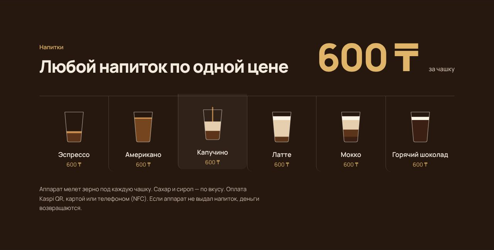
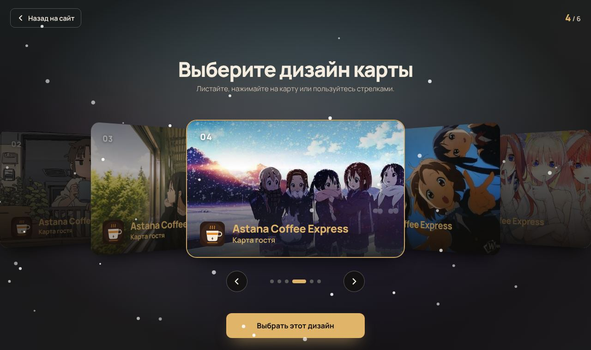
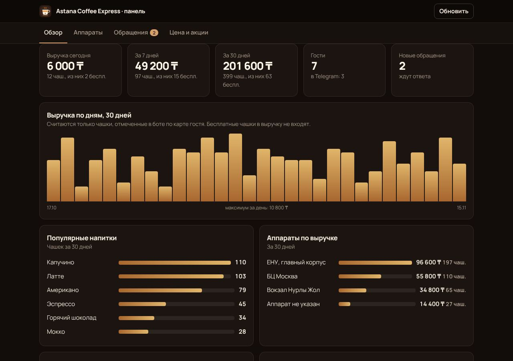
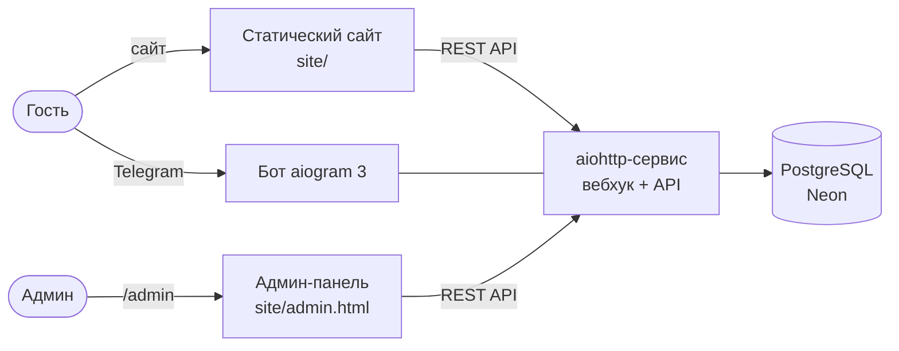

<div align="center">


# Astana Coffee Express

**Сайт, Telegram-бот с бонусной картой и админ-панель для сети кофе-аппаратов в Астане**

600 ₸ за любой напиток · 45 секунд · 24/7 · Kaspi QR, карта, NFC · каждая 6-я чашка бесплатно

[](https://github.com/kassse1/Astana-Coffee-Express/actions/workflows/tests.yml)


[**Сайт**](https://astana-coffee-express-site.onrender.com/) ·
[**Telegram-бот**](https://t.me/astanacoffeeexpress_bot) ·
[**Выбор дизайна карты**](https://astana-coffee-express-site.onrender.com/design.html) ·
[**Telegram-канал**](https://t.me/astanaCoffeeExpress)

</div>

<br>


## О проекте

Кофе-аппарат стоит в университете, бизнес-центре, клинике или на вокзале и продаёт сам, без бариста. Проекту нужно было три вещи:

1. **Сайт**, который за минуту объясняет формат: что за аппараты, сколько стоит, как купить и где найти.
2. **Причина возвращаться** — бонусная карта гостя без пластика и приложения: каждая шестая чашка бесплатно.
3. **Инструмент для владельцев** — видеть продажи, вести аппараты, отвечать на заявки и запускать акции.

Всё работает на бесплатных тарифах: сайт и бот на Render, база в Neon.

## Возможности

### Сайт
- Тёмный «кинематографичный» лендинг на **трёх языках** (русский, қазақша, English).
- **Заставка:** зёрна падают, перемалываются, и кофе льётся в стакан.
- **Живой аппарат** на первом экране: с каждой заполненной шкалой выбирается новый напиток и меняется свечение.
- **Интерактивное меню:** при наведении стакан наливается заново, слой за слоем.
- **Карта аппаратов** (Leaflet + OpenStreetMap): список точек, «открыто/закрыто» по времени Астаны, маршрут.
- **Карта гостя прямо на сайте:** регистрация, штрихкод, прогресс до бесплатной чашки, выбор из шести дизайнов.
- **3D-галерея дизайнов** с эффектами под каждую карту: лепестки, пар, снег, искры.
- **Калькулятор дохода** для владельцев помещений и **форма обращений** (установка, жалоба, возврат).

### Telegram-бот
- Регистрация и вход по логину и паролю, **общий аккаунт с сайтом**.
- Карта гостя картинкой: выбранный фон + штрихкод Code 128.
- Статистика гостя: сколько чашек, любимый напиток, сколько осталось до бесплатной.
- **Чашка за подписку** на Telegram-канал: бот сам проверяет подписку.
- Для админов: отметка покупки **по фото штрихкода**, список гостей, статистика, рассылка акций, выгрузка базы в Excel.
- Ссылка в админ-панель по команде `/admin`.

### Админ-панель
- Выручка за день, неделю и месяц, график по дням, популярные напитки, **выручка по каждому аппарату**.
- Программа лояльности: сколько бесплатных выдано, кому следующая чашка в подарок, самые активные гости.
- Аппараты с адресами, часами работы и координатами — сразу появляются на карте сайта.
- Обращения с сайта со статусами и заметками; о новом бот сразу пишет админам.
- Цена за чашку, строка акции на сайте, рассылка всем гостям.

## Скриншоты

| Напитки | Карта гостя | Карта в боте |
|---|---|---|
|  |  |  |

| Галерея дизайнов карты | Телефон |
|---|---|
|  |  |

**Админ-панель** (тестовые данные)



## Как это устроено



Бот и API живут в одном aiohttp-приложении на Render: Telegram присылает обновления на вебхук, а сайт и админ-панель обращаются к тем же данным через REST.

| Часть | Технологии |
|---|---|
| Сайт и админ-панель | HTML, CSS, JavaScript без фреймворков, Leaflet |
| Бот и API | Python 3.12, aiogram 3, aiohttp |
| Данные | SQLAlchemy 2, PostgreSQL (Neon); локально — Excel-файл через openpyxl |
| Штрихкоды | python-barcode (генерация), zxing-cpp (распознавание с фото) |
| Хостинг | Render (static site + web service), Neon |
| Тесты | pytest, GitHub Actions |

### Безопасность
- Пароли хранятся только в виде хеша PBKDF2-SHA256 с солью; сообщение с паролем бот сразу удаляет.
- Вход с сайта ограничен по числу попыток, токены подписаны HMAC.
- Админ-панель без пароля: личная подписанная ссылка из бота, действует 12 часов и только для ID из `ADMIN_IDS`.
- Пользовательский текст экранируется в боте, на сайте и в Excel-выгрузке.

## Структура

```
bot/            Telegram-бот, API сайта и админ-панели
  main.py       команды и кнопки бота, запуск (polling или вебхук)
  webapi.py     API карты гостя для сайта
  admin.py      API админ-панели: аппараты, продажи, обращения, настройки
  db.py         база в Excel-файле (локальный режим)
  sqldb.py      база в PostgreSQL (хостинг)
  barcodes.py   штрихкоды и картинка карты гостя
site/           сайт: лендинг, галерея дизайнов, админ-панель
tests/          автотесты
docs/           инструкция и скриншоты
render.yaml     конфигурация Render
```

## Быстрый старт

```bash
python -m venv .venv && source .venv/bin/activate
pip install -r requirements.txt
cp .env.example .env      # вписать BOT_TOKEN и ADMIN_IDS
python -m bot.main        # бот в режиме polling, база — data/coffee.xlsx
```

Сайт открывается без сборки: `site/index.html`.

Тесты:

```bash
pip install pytest && python -m pytest
```

Полная инструкция — база данных, бесплатный хостинг на Render и Neon, настройка сайта, админ-панели и акции за подписку: **[docs/SETUP.md](docs/SETUP.md)**.

---

<details>
<summary><b>English summary</b></summary>

Astana Coffee Express is a network of self-service coffee machines in Astana, Kazakhstan. This repository contains:

- a **trilingual landing page** (Russian, Kazakh, English) with an animated intro, an interactive drinks menu, a Leaflet map of machines, an income calculator for building owners and a request form;
- a **Telegram bot** (aiogram 3) with a loyalty card: personal Code 128 barcode, every 6th cup free, a free cup for subscribing to the Telegram channel, barcode scanning from a photo for staff, broadcasts and Excel export;
- a **guest card on the website** sharing the same account with the bot, and a 3D gallery to pick the card design;
- an **admin panel**: revenue by day and by machine, popular drinks, loyalty stats, machines with map coordinates, customer requests, price and promo settings; sign-in through a signed one-time link from the bot.

Stack: Python 3.12, aiogram 3, aiohttp, SQLAlchemy 2, PostgreSQL (Neon), vanilla HTML/CSS/JS, Leaflet, pytest. Hosted for free on Render.

</details>
