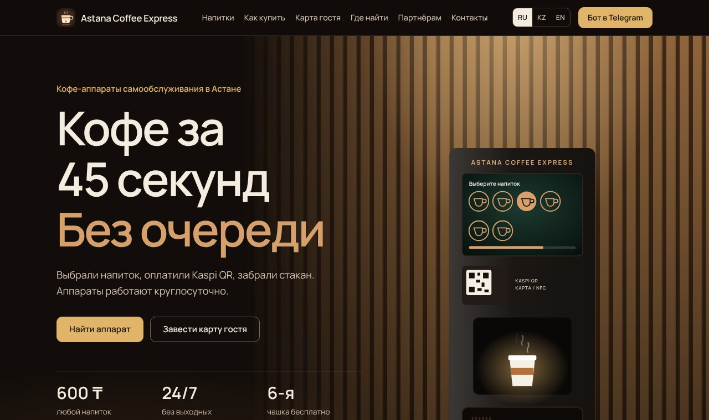
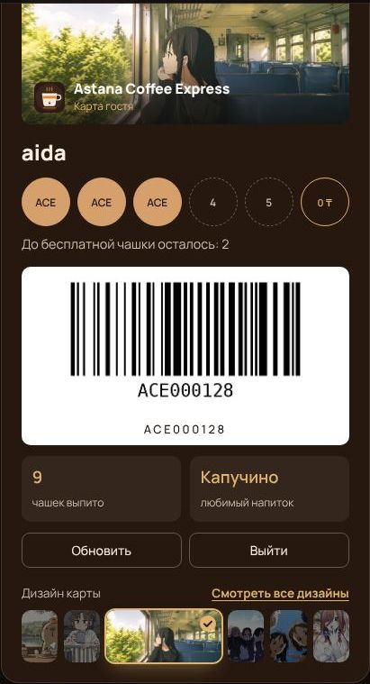
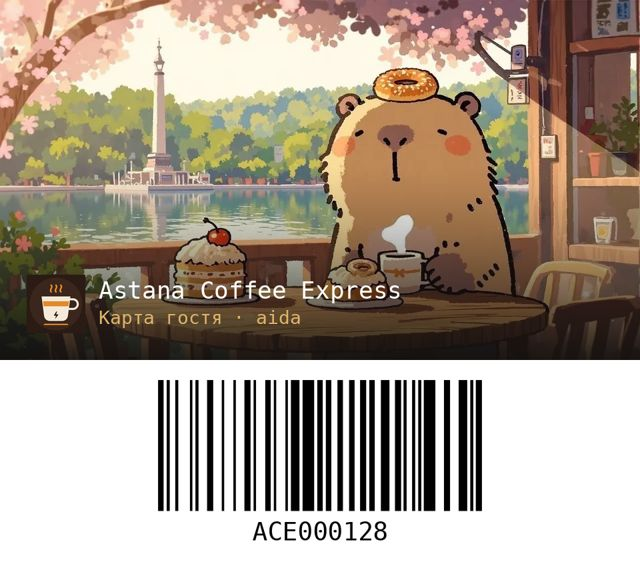
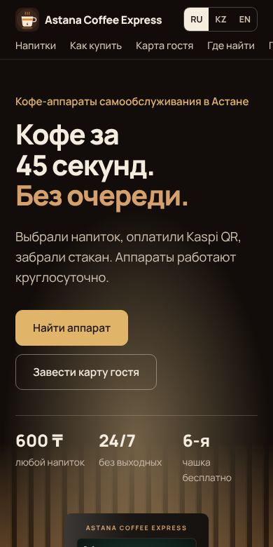
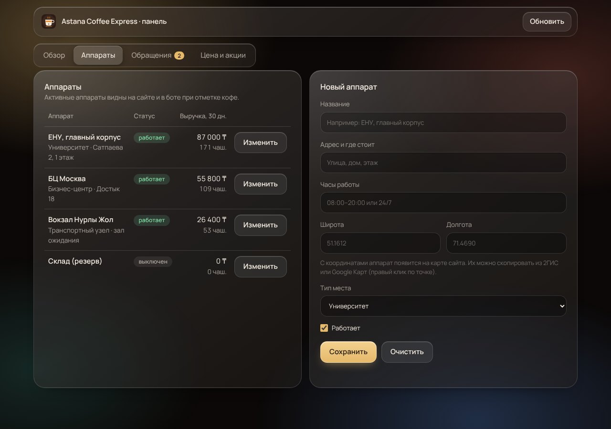
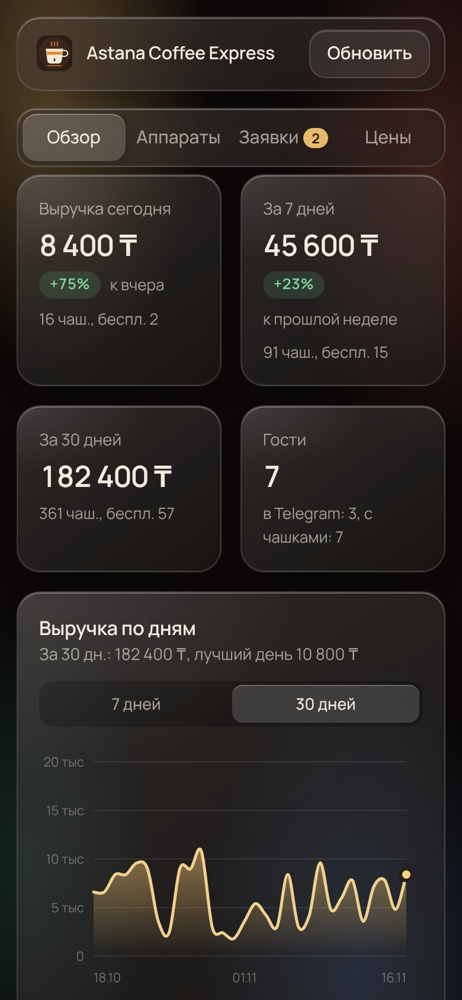
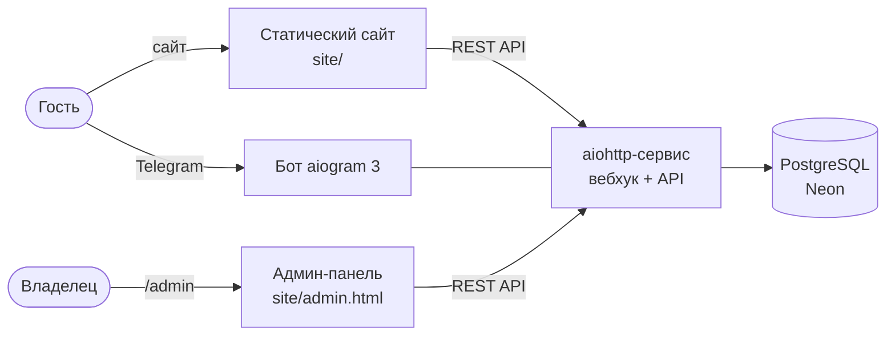

<div align="center">


# Astana Coffee Express

**Мой собственный проект: сеть кофе-аппаратов самообслуживания в Астане и весь её цифровой продукт — сайт на трёх языках, Telegram-бот с бонусной картой, REST API и админ-панель.**

Идею, дизайн, фронтенд, бэкенд, бота, базу данных, деплой и тесты сделал один человек — [Даниал Рахман](https://github.com/kassse1).

[](https://github.com/kassse1/Astana-Coffee-Express/actions/workflows/tests.yml)


[**Сайт**](https://astana-coffee-express-site.onrender.com/) ·
[**Telegram-бот**](https://t.me/astanacoffeeexpress_bot) ·
[**Галерея дизайнов карты**](https://astana-coffee-express-site.onrender.com/design.html) ·
[**Разбор решений**](docs/CASE_STUDY.md)

</div>

<br>



## Коротко

Я придумал формат: кофе-аппараты в университетах, бизнес-центрах и на вокзалах, любой напиток за 600 ₸ и 45 секунд, круглосуточно, оплата Kaspi QR или картой, каждая 6-я чашка бесплатно. Затем спроектировал и написал всё, что нужно такой сети, чтобы работать без бариста и без отдельного приложения:

| Для кого | Что получилось |
|---|---|
| **Гость** | Кинематографичный лендинг на русском, казахском и английском; бонусная карта в Telegram и на сайте с одним аккаунтом; карта аппаратов; чашка в подарок за подписку на канал |
| **Владелец сети** | Админ-панель: выручка по дням и аппаратам, популярные напитки, программа лояльности, аппараты на карте, обращения с сайта, цена и акции |
| **Сотрудник у аппарата** | Отметка покупки в боте по фото штрихкода гостя, рассылка акций, выгрузка базы в Excel |

Всё работает на бесплатных тарифах: сайт и бот на Render, база в Neon.

> Это концепт-проект: точки на карте, фото напитков и данные в админке на скриншотах — демонстрационные. Код, бот и сайт — рабочие.

## Что я сделал сам

- **Продукт и UX.** Придумал сценарии гостя, владельца и сотрудника, структуру сайта и тексты на трёх языках.
- **Дизайн и фронтенд.** Тёмный лендинг с анимированным SVG-аппаратом и заставкой-«роликом», 3D-галерея дизайнов карты, стеклянная админ-панель. Без фреймворков: HTML, CSS, JavaScript.
- **Бэкенд и API.** Одно aiohttp-приложение отвечает и за вебхук Telegram, и за REST API сайта и админки.
- **Telegram-бот** на aiogram 3: регистрация, карта гостя картинкой со штрихкодом, распознавание штрихкода по фото, проверка подписки на канал, рассылки.
- **Данные.** SQLAlchemy 2 и PostgreSQL на хостинге, Excel-файл для локального запуска, миграции схемы при старте.
- **Безопасность.** Хеши паролей PBKDF2, подписанные HMAC токены, ограничение попыток входа, экранирование пользовательского текста.
- **Инфраструктура и качество.** Деплой на Render и Neon, автотесты pytest и CI в GitHub Actions, замеры производительности в браузере с замедлением процессора.

## Инженерные решения и результаты

Подробно, с причинами и альтернативами, — в [docs/CASE_STUDY.md](docs/CASE_STUDY.md). Главное:

- **Одно приложение на бесплатном хостинге.** Бот работает через вебхук внутри того же aiohttp-сервиса, что и API. Один процесс, одна база, нет второго сервиса, который засыпает отдельно.
- **Один аккаунт для сайта и бота.** Гость регистрируется где угодно; дизайн карты, выбранный в галерее на сайте, сразу приходит картинкой в Telegram.
- **Админка без паролей.** Бот выдаёт владельцу личную ссылку с HMAC-подписью на 12 часов. Нечего утечь из базы, нечего подбирать.
- **Два хранилища за одним интерфейсом.** Excel-файл для разработки без базы и PostgreSQL на хостинге; бот и API не знают, с чем работают.
- **Три языка без библиотек.** Русский текст в разметке — ключ словаря; переключение языка проходит по текстовым узлам страницы. Цена за чашку приходит из API и подставляется во все тексты.
- **Производительность, подтверждённая замерами** (Chrome, процессор замедлен в 4 раза):
  - прокрутка админ-панели **24 → 61 кадр/с**: убрал `backdrop-filter` с десятков панелей, оставив размытие только на шапке;
  - переключение карт в 3D-галерее **39 → 58 кадров/с**: заранее размытые WebP-фоны вместо `filter: blur`, частицы на паузе во время поворота;
  - карта Leaflet загружается только при прокрутке к ней, а не вместе со страницей.

## Возможности

### Сайт
- Лендинг на трёх языках (русский, қазақша, English) с тёмной темой.
- **Заставка-ролик:** камера проходит по аппарату от зёрен до готового стакана; один раз за сессию, пропускается кликом или Esc.
- **Живой аппарат** на первом экране: с каждым циклом выбирается новый напиток и меняется свечение.
- **Интерактивное меню:** стакан наливается слой за слоем при наведении.
- **Карта аппаратов** (Leaflet и OpenStreetMap): «открыто/закрыто» по времени Астаны и маршрут; точки из админ-панели появляются сразу.
- **Карта гостя на сайте:** регистрация, штрихкод, прогресс до бесплатной чашки.
- **3D-галерея дизайнов карты** с объёмом, светом и частицами под каждую карту.
- **Калькулятор дохода** для владельцев помещений и **форма обращений** (установка, жалоба, возврат).

### Telegram-бот
- Регистрация и вход по логину и паролю, **общий аккаунт с сайтом**.
- Карта гостя картинкой: выбранный дизайн и штрихкод Code 128.
- Статистика гостя и сколько осталось до бесплатной чашки.
- **Чашка за подписку** на Telegram-канал: бот сам проверяет подписку.
- Для сотрудников: отметка покупки **по фото штрихкода**, выбор аппарата, рассылка, выгрузка в Excel. Команда `/admin` выдаёт ссылку в админ-панель.

### Админ-панель
- Выручка за день, неделю и месяц с динамикой, график по дням (7 и 30), загрузка по часам, **выручка по каждому аппарату**, популярные напитки.
- Программа лояльности: сколько чашек бесплатных, кому следующая в подарок, самые активные гости.
- Аппараты с адресами, часами и координатами.
- Обращения с сайта со статусами и заметками; удаление по одному или всех закрытых сразу. О новом обращении бот пишет сразу.
- Цена за чашку, строка акции на сайте, рассылка всем гостям.

## Скриншоты

### Сайт

| Напитки | Карта гостя | Карта в боте |
|---|---|---|
|  |  |  |

| Галерея дизайнов карты | Телефон |
|---|---|
|  |  |

### Админ-панель (тестовые данные)


| Аппараты | Телефон |
|---|---|
|  |  |

## Как это устроено



| Часть | Технологии |
|---|---|
| Сайт и админ-панель | HTML, CSS, JavaScript без фреймворков, SVG-анимации, Canvas, Leaflet |
| Бот и API | Python 3.12, aiogram 3, aiohttp |
| Данные | SQLAlchemy 2, PostgreSQL (Neon); локально Excel-файл через openpyxl |
| Штрихкоды | python-barcode (генерация), zxing-cpp (распознавание с фото), Pillow (картинка карты) |
| Хостинг | Render (static site + web service), Neon |
| Качество | pytest (14 тестов: бот, API, админ-панель, подписка), GitHub Actions |

### Безопасность
- Пароли хранятся только как хеш PBKDF2-SHA256 с солью; сообщение с паролем бот сразу удаляет.
- Вход с сайта ограничен по числу попыток; токены сайта и админки подписаны HMAC.
- Админ-панель: личная подписанная ссылка из бота, действует 12 часов и только для ID из `ADMIN_IDS`.
- Пользовательский текст экранируется в боте, на сайте и в Excel-выгрузке; форма обращений ограничена по частоте.

## Структура

```
bot/            Telegram-бот, API сайта и админ-панели
  main.py       команды и кнопки бота, запуск (polling или вебхук)
  webapi.py     API карты гостя для сайта
  admin.py      API админ-панели: аппараты, продажи, обращения, настройки
  db.py         база в Excel-файле (локальный режим)
  sqldb.py      база в PostgreSQL (хостинг)
  barcodes.py   штрихкоды и картинка карты гостя
site/           сайт: лендинг, галерея дизайнов, админ-панель
tests/          автотесты
docs/           инструкция, разбор решений и скриншоты
render.yaml     конфигурация Render
```

## Быстрый старт

```bash
python -m venv .venv && source .venv/bin/activate
pip install -r requirements.txt
cp .env.example .env      # вписать BOT_TOKEN и ADMIN_IDS
python -m bot.main        # бот в режиме polling, база — data/coffee.xlsx
```

Сайт открывается без сборки: `site/index.html`.

Тесты:

```bash
pip install pytest && python -m pytest
```

Полная инструкция — база данных, бесплатный хостинг на Render и Neon, настройка сайта, админ-панели и акции за подписку: **[docs/SETUP.md](docs/SETUP.md)**.

## Автор

**Даниал Рахман** — идея, дизайн, разработка, деплой и тесты. GitHub: [kassse1](https://github.com/kassse1).

---

<details>
<summary><b>English summary</b></summary>

Astana Coffee Express is my own end-to-end project: a concept for a network of self-service coffee machines in Astana, Kazakhstan, and the complete digital product around it. I designed and built it alone: product, UX, design, frontend, backend, Telegram bot, data, deployment and tests.

- a **trilingual landing page** (Russian, Kazakh, English) with an animated SVG machine, a cinematic intro, an interactive drinks menu, a Leaflet map of machines, an income calculator and a request form;
- a **Telegram bot** (aiogram 3) with a loyalty card: personal Code 128 barcode, every 6th cup free, a free cup for subscribing to the channel, barcode scanning from a photo for staff, broadcasts and Excel export;
- a **guest card on the website** sharing one account with the bot, and a 3D gallery to pick the card design;
- an **admin panel**: revenue by day and by machine, popular drinks, loyalty stats, machines with map coordinates, customer requests, price and promo settings; sign-in through a signed link from the bot.

Engineering highlights: one aiohttp service for the Telegram webhook and the REST API, HMAC-signed tokens, PBKDF2 passwords, two storage backends behind one interface, i18n without libraries, and measured performance work (admin scrolling 24 → 61 fps, gallery switching 39 → 58 fps with 4× CPU throttling).

Stack: Python 3.12, aiogram 3, aiohttp, SQLAlchemy 2, PostgreSQL (Neon), vanilla HTML/CSS/JS, Leaflet, pytest, GitHub Actions. Hosted for free on Render. Map points and admin data in the screenshots are demo data.

</details>
