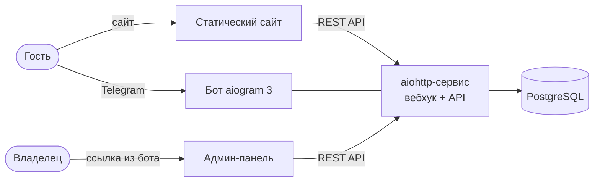

# Astana Coffee Express: разбор решений

Автор: **Даниал Рахман**. Проект придуман и сделан мной целиком: идея, UX, дизайн, фронтенд, бэкенд, Telegram-бот, данные, деплой и тесты. Здесь — почему проект устроен именно так, какие были трудности и чем они закончились.

## Задача

Сеть кофе-аппаратов самообслуживания продаёт без бариста. Ей нужно:

1. **Объяснить формат** за минуту: что за аппараты, сколько стоит, как купить, где найти.
2. **Вернуть гостя ещё раз** без пластиковой карты и без отдельного приложения.
3. **Дать владельцу инструмент**: продажи, аппараты, обращения гостей, акции.

Ограничения я поставил себе сам: всё должно работать на бесплатных тарифах, у гостя ничего не скачивается, сайт быстрый на обычном телефоне.

## Архитектура

- **Сайт и админ-панель** — статические страницы без сборки, лежат на Render как static site.
- **Бот и API** — одно aiohttp-приложение на Render: Telegram присылает обновления на вебхук, сайт и админка ходят в тот же процесс за данными.
- **База** — PostgreSQL в Neon.

## Ключевые решения

### Бот и API в одном процессе
**Почему.** Бесплатный веб-сервис на Render засыпает без запросов. Два отдельных сервиса (бот и API) просыпались бы по отдельности, и гость ждал бы дважды. Один процесс с вебхуком отвечает и Telegram, и сайту, а база одна.
**Цена решения.** Падение API кладёт и бота. Для проекта такого масштаба это приемлемо, а тесты покрывают оба входа.

### Один аккаунт для сайта и бота
Гость регистрируется в боте или на сайте, а логин работает в обоих местах. Карта гостя одна: штрихкод, счётчик чашек, выбранный дизайн. Дизайн, выбранный в 3D-галерее на сайте, сохраняется через API, и бот сразу присылает новую картинку карты.

### Админ-панель без паролей
Владелец отправляет боту `/admin` и получает личную ссылку. В ней токен с HMAC-подписью, ID администратора и сроком действия 12 часов. На сервере нет таблицы паролей админов, которую можно украсть, и нечего подбирать. Токен хранится в sessionStorage и убирается из адресной строки.

### Два хранилища за одним интерфейсом
Для разработки база — Excel-файл: бот запускается без Postgres и Docker, данные можно открыть глазами. На хостинге — PostgreSQL через SQLAlchemy 2. Код бота и API работает с одним интерфейсом и не знает, что под ним. Новые поля (дизайн карты, бонус за подписку, координаты аппаратов) добавляются миграциями при старте.

### Три языка без библиотек
Русский текст в разметке — это ключ словаря, значения — казахский и английский. Переключатель проходит по текстовым узлам страницы и подменяет их, исходный текст запоминается в самом узле. Цена за чашку приходит из API и подставляется во все тексты, где она упоминается: владелец меняет цену в админке, и сайт обновляется без правок кода.

### Штрихкоды
Карта гостя — Code 128, картинка собирается на сервере через Pillow: фон выбранного дизайна, имя и штрихкод. Сотрудник фотографирует штрихкод с телефона гостя, и бот распознаёт его через zxing-cpp. Ручной ввод логина тоже работает.

### Подписка на канал
Бот проверяет подписку через `getChatMember` и даёт одну бесплатную чашку. Использовать бота можно и без подписки: это бонус, а не стена.

## Трудности и как я их решил

### Админ-панель тормозила при прокрутке
**Симптом.** На ноутбуке прокрутка дашборда дёргалась.
**Причина.** У каждой стеклянной панели был `backdrop-filter: blur`. При прокрутке браузер на каждом кадре заново размывал всё под дюжиной карточек.
**Решение.** Размытие оставил только на шапке и вкладках. Панели получили полупрозрачный градиент с бликом по краю, а цветной фон вынесен в отдельный слой, который не перерисовывается.
**Результат.** Прокрутка при замедленном в 4 раза процессоре: **24 → 61 кадр/с** на компьютере, 58 → 61 на телефоне. Вид почти не изменился.

### 3D-галерея дизайнов теряла кадры
**Симптом.** Поворот карусели с эффектами частиц проседал.
**Причина.** Размытые фоны считались через `filter: blur` на лету, тени перерисовывались каждый кадр, частицы работали во время поворота.
**Решение.** Фоны заранее размыты и сохранены как WebP, тени и свет считаются через `@property`-переменные, частицы ставятся на паузу во время поворота.
**Результат.** **39 → 58 кадров/с** при переключении карт с замедлением процессора.

### Карта аппаратов утяжеляла страницу
Leaflet (библиотека и стили) лежит в проекте и подгружается, только когда гость долистал до раздела «Где найти». Первый экран не платит за карту, которую многие не увидят.

### Безопасность публичного API
- Пароли хранятся только как PBKDF2-SHA256 с солью, сообщение с паролем бот удаляет сразу.
- Вход с сайта и форма обращений ограничены по частоте с одного адреса.
- Пользовательский текст экранируется везде, где выводится: в боте, на сайте, в админке и в Excel-выгрузке.

## Как я проверял

- **pytest, 14 тестов**: регистрация и вход, карта гостя и картинка карты, API админ-панели (продажи, аппараты, обращения, удаление), бонус за подписку, сценарии бота с подменённым Telegram API.
- **GitHub Actions** запускает тесты на каждый push.
- **Playwright-скрипты** для проверки вёрстки: нет горизонтальной прокрутки на ширинах 360–1280, нет ошибок в консоли, замеры кадров при прокрутке с замедлением процессора через Chrome DevTools Protocol.

## Что бы я сделал дальше

- Реальная интеграция оплаты Kaspi, чтобы чашка засчитывалась без сотрудника.
- Учёт остатков ингредиентов в аппаратах и уведомления о пополнении.
- Отдельный сервис для бота, когда нагрузка вырастет и связка «бот и API в одном процессе» станет узким местом.
